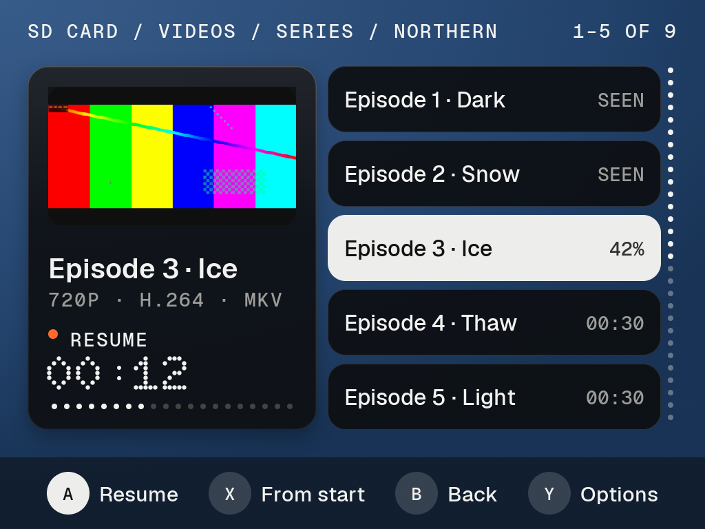
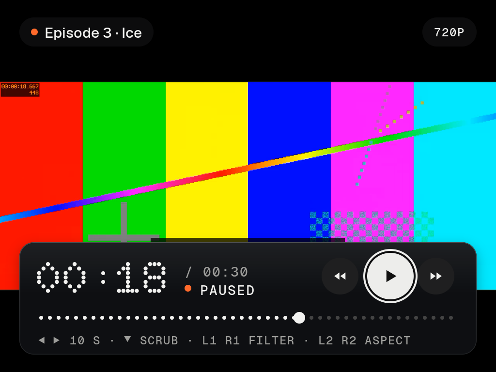
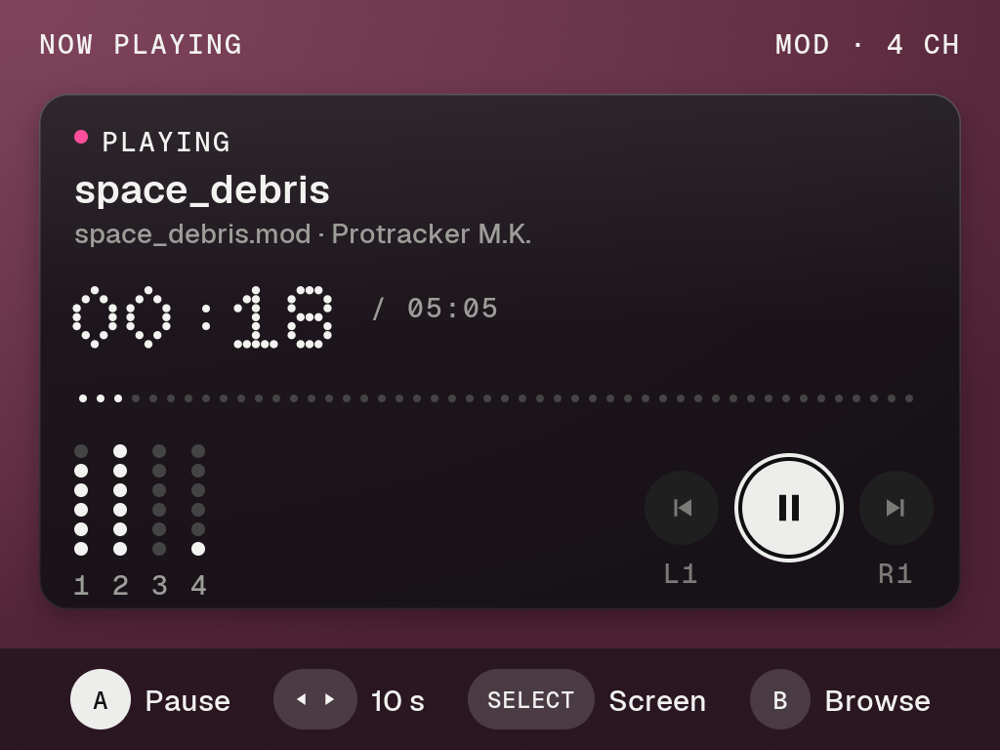
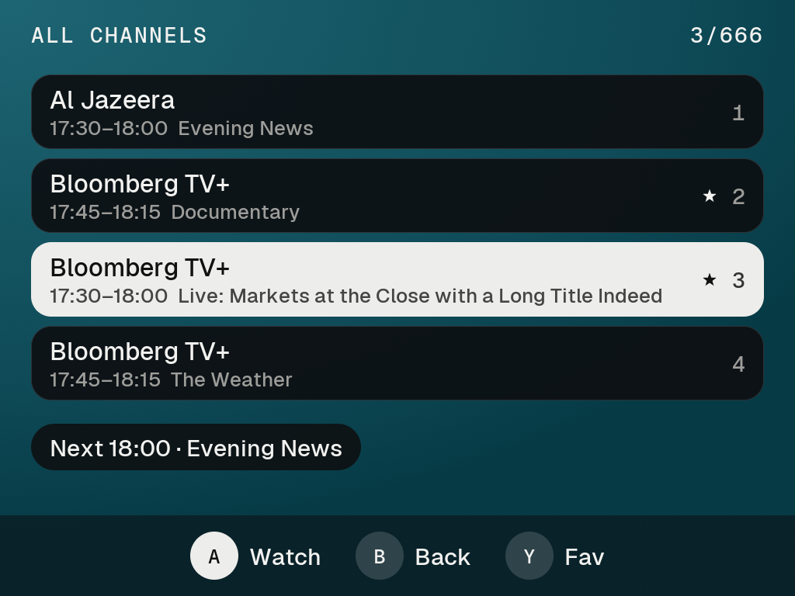
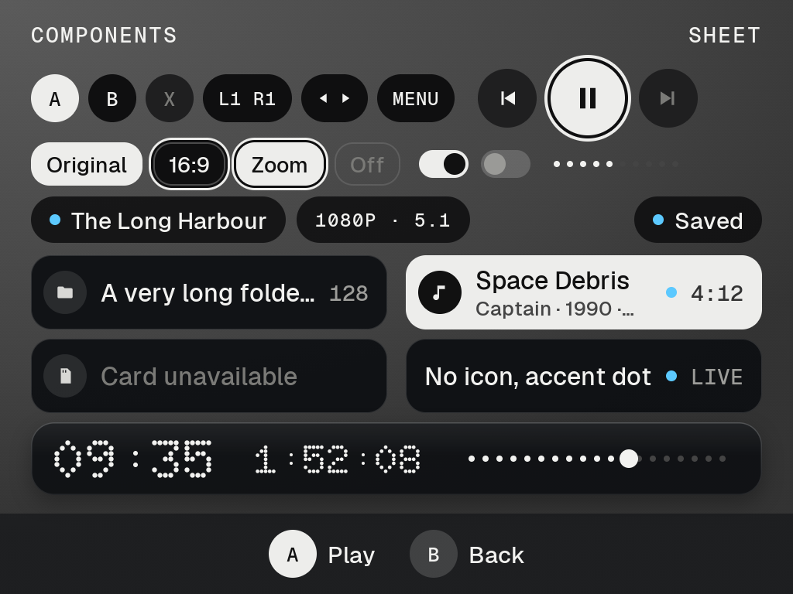

# Dot

The shared look of the NextUI paks Kino, Musicdisk, Tuner and Speed (TrimUI Brick, 1024x768 at about 400 ppi): dark
glass cards on an evening colour of each app's own, white for where you are, one accent dot for what is happening,
dot-matrix numbers and titles, and type sized for the small screen (list rows 32 px).

Kino, Musicdisk and Tuner, and the component sheet `test/shots.sh` renders.

Added to each pak as a git submodule (`ui/dot`). C + SDL2 + SDL2_ttf.

- `src/dot_tokens.h`: colours, type scale, sizes and layout bands (the same numbers as the style guide page).
- `src/dot.h`, `src/dot.c`: the library. `dot_init(renderer, font_dir, accent)` and `dot_set_theme(d, &theme)` with the
  app's `DOT_THEME_*` (its evening ground and accent), then per frame `dot_frame` and the
  draw calls (ground, card, text, time, header, row, key, round, pill, toast, chip, toggle, slider, progress,
  option rows, panel, dock). Cards and rows are charcoal glass over the ground; `dot_set_backdrop` lets rounded
  corners take the colour of a picture drawn behind. Shapes and text are rendered once in software and cached as white textures tinted
  per draw, so it needs only SDL_Renderer (no SDL_RenderGeometry, works with SDL 2.0.14).
- `test/shots.sh`: renders the guide's screens and a component sheet with the library to `test/shots/*.png`
  (Docker, headless software renderer), to compare with the style guide.
- `fonts/`: Doto (round dots, static Black/Bold instances of the variable font), Geist, Geist Mono. All SIL OFL.

Buttons: A confirm/play, B back/close, X secondary, Y options, L1/R1 page or jump, SELECT switch view,
START now playing, MENU quit. The dock shows only what works on the current screen, at most four hints.
